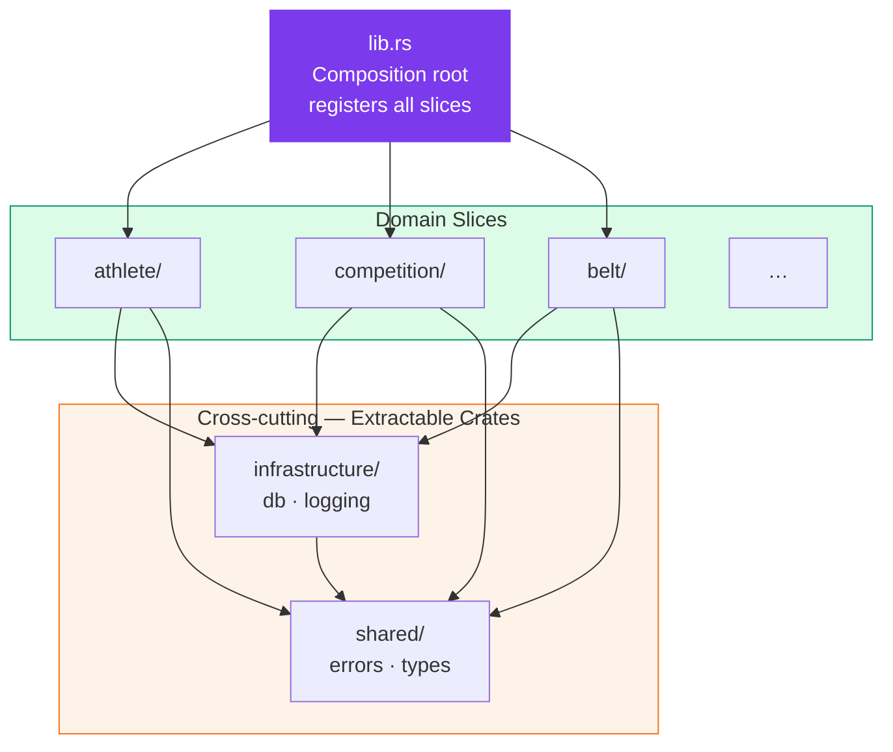
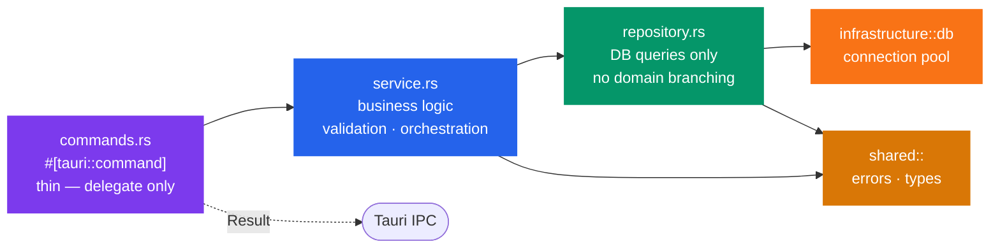
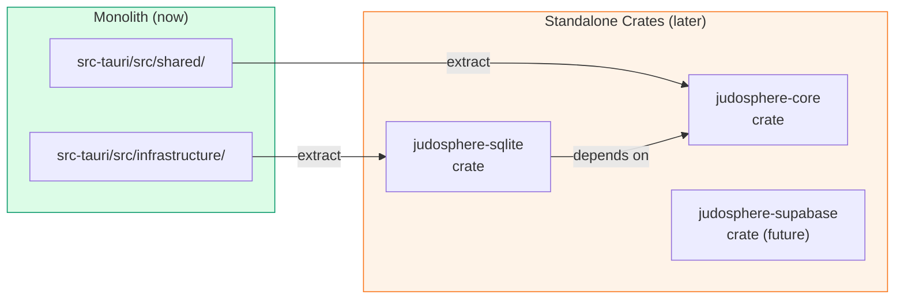
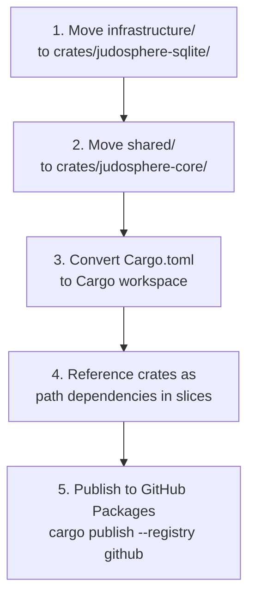

# Backend Architecture — Vertical Slices

> Applies to all files under `src-tauri/`.

The Rust backend is structured as **Vertical Slices**. Each domain owns its entire stack — from the Tauri command registration down to the database query — with no cross-slice dependencies.

---

## Slice Overview



---

## Directory Structure

```
src-tauri/src/
├── lib.rs                          # Composition root — registers all slices
├── main.rs                         # Tauri entry point
│
├── shared/                         # Extractable → judosphere-core
│   ├── mod.rs
│   ├── errors.rs                   # AppError, Result alias
│   └── types.rs                    # Shared value objects (e.g. BeltRank)
│
├── infrastructure/                 # Extractable → judosphere-sqlite
│   ├── mod.rs
│   ├── db.rs                       # Connection pool (tauri-plugin-sql / rusqlite)
│   └── logging.rs                  # Tracing setup
│
├── athlete/                        # Slice: athlete management
│   ├── mod.rs                      # pub fn register(builder) -> builder
│   ├── commands.rs                 # #[tauri::command] functions
│   ├── service.rs                  # Business logic
│   ├── repository.rs               # DB queries only
│   └── models.rs                   # Domain models & DTOs (serde)
│
├── competition/                    # Slice: competition management
│   ├── mod.rs
│   ├── commands.rs
│   ├── service.rs
│   ├── repository.rs
│   └── models.rs
│
├── belt/                           # Slice: belt & grading management
│   ├── mod.rs
│   ├── commands.rs
│   ├── service.rs
│   ├── repository.rs
│   └── models.rs
│
└── …                               # Further slices as needed
```

---

## Layer Flow Within a Slice



| File            | Responsibility                                                                                    |
| --------------- | ------------------------------------------------------------------------------------------------- |
| `commands.rs`   | `#[tauri::command]` functions only — no logic, no DB access, delegate immediately to `service.rs` |
| `service.rs`    | Business logic, validation, orchestration — calls `repository.rs`                                 |
| `repository.rs` | DB queries exclusively — no domain branching, no business logic                                   |
| `models.rs`     | Domain models, DTOs (`serde`), optional mapping functions                                         |
| `mod.rs`        | Exports `pub fn register(builder) -> builder` — registers the slice's commands                    |

---

## `lib.rs` — Composition Root

`lib.rs` is the **only** place where slices are wired together. It calls each slice's `register()` function and sets up infrastructure.

```rust
// src-tauri/src/lib.rs

pub fn run() {
    tauri::Builder::default()
        .plugin(tauri_plugin_opener::init())
        .setup(|app| {
            infrastructure::db::setup(app)?;
            Ok(())
        })
        .invoke_handler(tauri::generate_handler![
            athlete::commands::create_athlete,
            athlete::commands::list_athletes,
            competition::commands::create_competition,
            belt::commands::record_grading,
            // …
        ])
        .run(tauri::generate_context!())
        .expect("error while running tauri application");
}
```

---

## Slice Rules

1. **Commands are thin** — deserialise input and delegate to `service.rs`. No logic, no DB access.
2. **No direct cross-slice imports** — shared types via `crate::shared::*`, never `crate::athlete::` from `crate::competition::`.
3. **Unified errors** — all `repository.rs` functions return `Result<T, crate::shared::errors::AppError>`.
4. **No business logic in `repository.rs`** — SQL only, no domain-level branching.
5. **New domain = new slice folder** — never add to an existing slice.

---

## Extractable Crates

The modules `infrastructure/` and `shared/` are designed from day one to be extracted as standalone Rust crates and published to the GitHub Package Feed (private registry).



### Extraction Rules

1. **No slice dependencies** — `infrastructure/` and `shared/` must never import slice code (`athlete`, `competition`, …).
2. **Clean public API** — everything a future crate will export is already behind a well-defined `pub` interface in `mod.rs`.
3. **Feature flags from day one** — conditional compilation is prepared even if only one backend is active initially:

```toml
# Cargo.toml
[features]
default = ["sqlite"]
sqlite   = ["dep:rusqlite"]    # or tauri-plugin-sql
# supabase = ["dep:postgrest"] # future
```

4. **No `tauri` types in extractable modules** — `infrastructure/db.rs` and `shared/` must not reference any `tauri::*` types. Tauri integration stays in `lib.rs` and slice `commands.rs`.
5. **Changelog sections** — each extractable module maintains its own `CHANGELOG.md` section to keep the extraction cut traceable.

### Crate Candidates

| Module (now)                      | Future crate          | Content                                               |
| --------------------------------- | --------------------- | ----------------------------------------------------- |
| `src-tauri/src/infrastructure/db` | `judosphere-sqlite`   | SQLite abstraction, connection pool, migration helper |
| `src-tauri/src/shared/`           | `judosphere-core`     | Shared error types, `Result` alias, value objects     |
| _(future)_                        | `judosphere-supabase` | Supabase client wrapper, auth, realtime               |

### Migration Plan

When ready to extract:



```toml
# Future workspace Cargo.toml
[workspace]
members = [
    "judosphere-app",     # src-tauri (Tauri shell + slices)
    "judosphere-sqlite",  # extracted from infrastructure/
    "judosphere-core",    # extracted from shared/
]
```

---

## Checklist for New Slice Files

1. New domain? → create a new slice folder, never extend an existing one.
2. `commands.rs` contains **only** `#[tauri::command]` functions that immediately delegate.
3. `service.rs` contains all business logic — never touches DB directly.
4. `repository.rs` contains only SQL — no domain conditions.
5. `models.rs` has `serde::Serialize` / `serde::Deserialize` on all DTOs.
6. `mod.rs` exposes `pub fn register()` and nothing else from the internals.
7. Slice uses `crate::shared::errors::AppError` — no custom ad-hoc error types.
8. New slice added to `lib.rs` `invoke_handler!` macro.
9. Matching DTO added to `src/shared/types/` (TypeScript) in the same commit.
