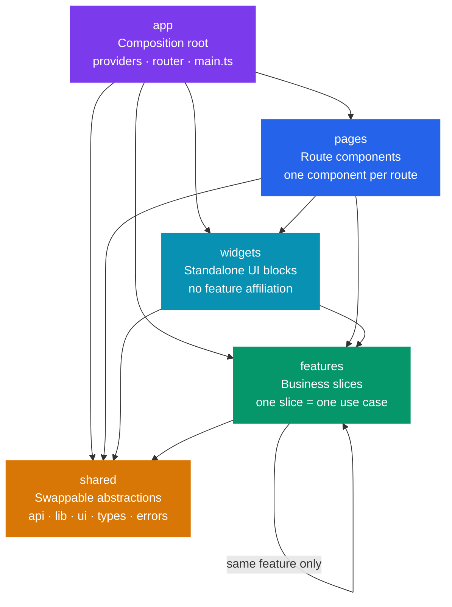
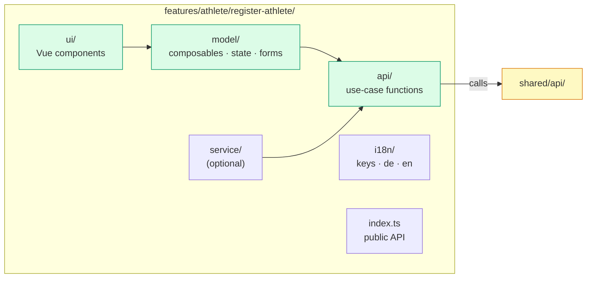

# Frontend Architecture — Feature-Sliced Design (FSD)

> Applies to all files under `src/`.

The renderer is structured according to **Feature-Sliced Design**. Code lives under `src/` in five layers. Imports may only flow **downward** — never from `shared` toward `features`, `pages`, `widgets`, or `app`.

---

## Layer Hierarchy



**Import rule:** Each layer may only import from layers below it. Imports in the opposite direction are forbidden.

---

## Directory Structure

```
src/
├── app/                        # Composition root
│   ├── providers/              # Router, Pinia, i18n, UI framework setup
│   └── main.ts                 # Entry point — wires all providers
│
├── pages/                      # Route components
│   └── <page-name>/
│       ├── ui/
│       │   ├── <Name>.vue
│       │   ├── <Name>.stories.ts
│       │   └── <Name>.e2e.spec.ts
│       └── index.ts            # Public API
│
├── widgets/                    # Standalone UI building blocks
│   └── <widget-name>/
│       ├── ui/
│       │   ├── <Name>.vue
│       │   ├── <Name>.stories.ts
│       │   └── <Name>.e2e.spec.ts
│       ├── i18n/               # (optional)
│       └── index.ts
│
├── features/                   # Business functionality
│   └── <feature>/
│       └── <slice>/
│           ├── ui/
│           │   ├── <Name>.vue
│           │   ├── <Name>.stories.ts
│           │   └── <Name>.e2e.spec.ts
│           ├── model/          # Composables, state, form logic
│           ├── api/            # Use-case API — wraps shared/api
│           ├── i18n/           # keys.ts · de.ts · en.ts · index.ts
│           ├── service/        # (optional) orchestration
│           └── index.ts        # Public API — export only here
│
└── shared/                     # Swappable abstractions
    ├── api/                    # IPC bridge client (+ future Supabase client)
    ├── lib/
    │   ├── browser/
    │   ├── validation/
    │   ├── pinia/
    │   ├── i18n/
    │   └── logging/            # logError — the only logging public API
    ├── ui/                     # Reusable Vue components (no feature affiliation)
    ├── model/
    ├── store/
    ├── types/                  # Shared DTOs (mirrored in src-tauri/src/shared/types.rs)
    └── errors/
```

---

## Layer Descriptions

### `app` — Composition Root

- Contains everything that **composes** the renderer application; not further abstracted.
- Examples: Vue Router instance, Pinia setup, i18n plugin, UI framework registration.
- The router imports **only** page components from `@pages/*`.
- Router guards may use `features` / `shared` for app-wide orchestration (e.g. auth check).
- Do not register feature or widget UI directly in the router.

### `pages` — Route Components

- One page component per route. The router knows only `@pages/*`.
- Pages **compose** features and optionally widgets. They contain **no business logic**.
- Structure per page: `ui/` + `index.ts`.
- Every file in `ui/` ships as a triplet: `<Name>.vue` · `<Name>.stories.ts` · `<Name>.e2e.spec.ts`.

### `widgets` — Standalone UI Blocks

- Self-contained UI building blocks without a specific feature affiliation (e.g. `Navigation`, `Sidebar`).
- May use `features` and `shared`, but should not be imported by pages when mounted globally (use `app/providers/` instead).
- Structure: `ui/` · optional `i18n/` · `index.ts`.
- Every component in `ui/` requires colocated `<Name>.stories.ts` and `<Name>.e2e.spec.ts`.

### `features` — Business Slices

Business functionality divided into **slices**. One slice = one cohesive use case.



**API layering rules:**
- Generic client access lives in `shared/api/` (IPC bridge, future Supabase).
- Each slice gets its own `api/` folder with **use-case-specific** functions that call `shared/api` and handle errors at slice level.
- `model/` and `service/` import **only** from the slice's own `api/`, never directly from `@shared/api`.
- Cross-slice logic within the same feature belongs in `features/<feature>/service/` or `model/`.
- Slices may use other slices **of the same feature**, but **not** other features, pages, or widgets.
- Add new functionality as a **new slice**; never mix into an existing slice.

### `shared` — Swappable Abstractions

No feature or page logic. Features and widgets import only the public API — never the SDK directly.

| Segment                             | Level      | Content                                               |
| ----------------------------------- | ---------- | ----------------------------------------------------- |
| `api/`                              | Low-level  | IPC bridge client, future Supabase client             |
| `lib/browser/` `lib/validation/` `lib/pinia/` `lib/i18n/` | Low-level | Technical helpers, validation, store utilities |
| `lib/logging/`                      | High-level | Error logging via `logError` (the only logging API)   |
| `ui/`                               | —          | Reusable Vue components without feature affiliation   |
| `model/` `store/` `types/` `errors/`| —          | Shared domain types, stores, error classes            |

- `shared` imports **no** features, pages, widgets, or `app`.
- Vue components without feature affiliation → `shared/ui/`, not in features.
- Every component in `shared/ui/` requires colocated `<Name>.stories.ts` and `<Name>.e2e.spec.ts`.

---

## `app` vs. `shared` — Decision Guide

| Question                                                             | → `app` | → `shared` |
| -------------------------------------------------------------------- | ------- | ---------- |
| Part of the **composition root** (start app, register plugins)?      | Yes     | No         |
| **Swappable / mockable** without rewriting features?                 | No      | Yes        |
| Should features **not import this SDK directly**?                    | —       | Yes        |
| Switching mainly requires wiring changes in `main.ts` / `providers/`?| Yes     | No         |

**Split pattern:** A dependency can be both — instance/wiring in `app/providers/`, usage API in `shared/lib/` (e.g. plugin registered in `app`, composable consumed via `shared`).

---

## Import Aliases

Always use path aliases — never use relative paths across layer boundaries.

| Alias          | Maps to          |
| -------------- | ---------------- |
| `@app/*`       | `src/app/*`      |
| `@pages/*`     | `src/pages/*`    |
| `@widgets/*`   | `src/widgets/*`  |
| `@features/*`  | `src/features/*` |
| `@shared/*`    | `src/shared/*`   |

---

## Checklist for New Files

1. Correct layer and slice chosen?
2. **app vs. shared:** wiring (→ `app`) or swappable abstraction (→ `shared`)?
3. Import direction respected — only downward?
4. Public API exported exclusively via `index.ts`?
5. i18n keys placed in the slice's `i18n/`, not in `shared`?
6. Reusable UI without feature affiliation → `shared/ui/`?
7. API access via `shared/api` → slice `api/` as intermediary, **not** directly in `model/`?
8. New or changed file in `ui/` → colocated `<Name>.stories.ts` and `<Name>.e2e.spec.ts` committed in the same change?
