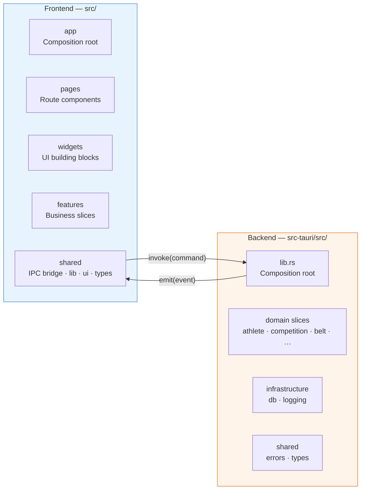
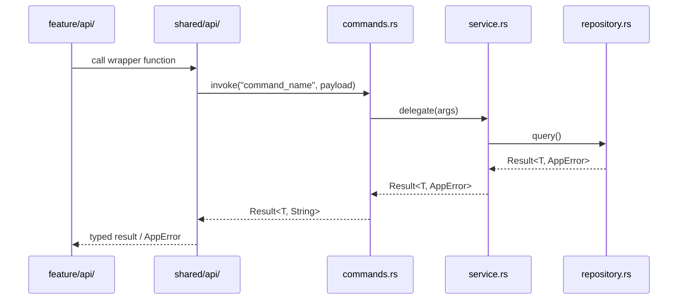

# JudoSphere — Architecture Overview

JudoSphere is a desktop application built on **Tauri 2** (Rust backend) and **Vue 3** (frontend renderer). Both sides follow distinct, clearly separated architectural principles.

> **Detailed rule sets:**
>
> - Frontend (Vue / FSD): [`architecture-frontend.md`](architecture-frontend.md)
> - Backend (Tauri / Vertical Slices): [`architecture-backend.md`](architecture-backend.md)

---

## System Overview

---

## IPC Boundary (Vue ↔ Tauri)

**Rules:**

- All `invoke` / `listen` calls live exclusively in `src/shared/api/`. Features never call `window.__TAURI__` directly.
- Command names are `snake_case` and defined in the slice's `commands.rs`.
- Shared DTOs are maintained in parallel: `src/shared/types/` (TypeScript) and `src-tauri/src/shared/types.rs` (Rust). A change on one side always requires a matching change on the other.
- Commands return `Result<T, String>` (Tauri-compatible); Vue maps the error string to a typed `AppError` inside `shared/api/`.

---

## Extractable Crates — at a Glance

Selected infrastructure modules are implemented as **in-monolith modules today** but are designed from day one to be extracted as standalone Rust crates and published to the GitHub Package Feed.

| Module (now)                      | Future crate name     | Responsibility                                        |
| --------------------------------- | --------------------- | ----------------------------------------------------- |
| `src-tauri/src/infrastructure/db` | `judosphere-sqlite`   | SQLite abstraction, connection pool, migration helper |
| `src-tauri/src/shared/`           | `judosphere-core`     | Shared error types, Result alias, value objects       |
| _(future)_                        | `judosphere-supabase` | Supabase client wrapper, auth, realtime               |

See [`architecture-backend.md`](architecture-backend.md#extractable-crates) for the full extraction rules and migration plan.

---

## Quick Reference — Which Rule Applies Where?

| Area                            | Architectural principle  | Key constraint                           |
| ------------------------------- | ------------------------ | ---------------------------------------- |
| `src/app/`                      | FSD — Composition root   | No feature imports, wiring only          |
| `src/pages/`                    | FSD — Route components   | No business logic                        |
| `src/widgets/`                  | FSD — UI building blocks | No direct export to pages when global    |
| `src/features/`                 | FSD — Use cases          | Slices only; no cross-feature imports    |
| `src/shared/`                   | FSD — Abstractions       | No imports from higher layers            |
| `src-tauri/src/<slice>/`        | Vertical slices          | No cross-slice imports                   |
| `src-tauri/src/infrastructure/` | Extractable crate        | No Tauri types, no slice dependencies    |
| `src-tauri/src/shared/`         | Extractable crate        | Pure domain types and error classes only |
