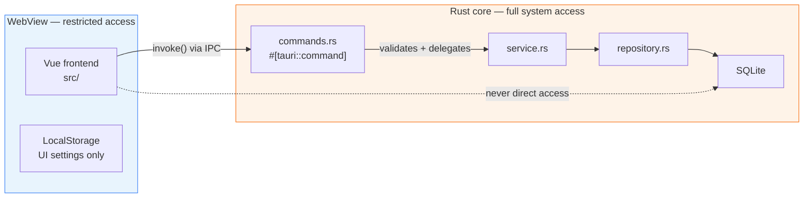
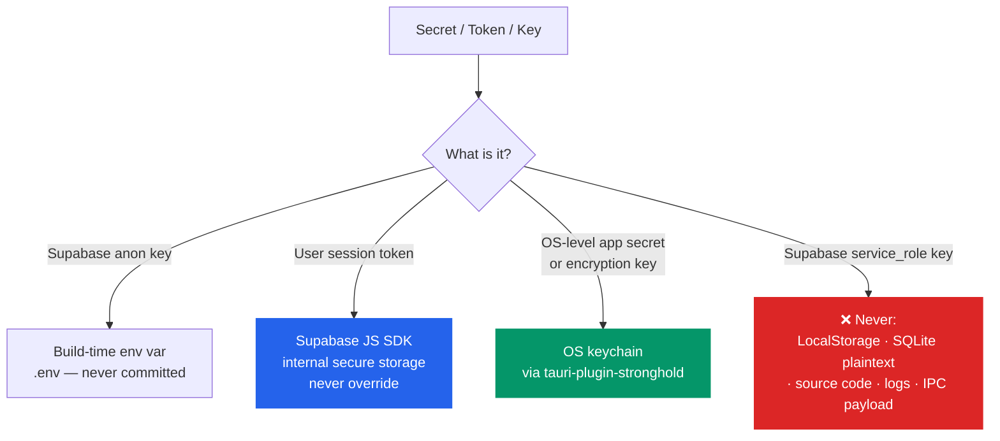

# Security & Privacy

These rules apply to every implementation. They are technical guardrails derived from the official Tauri 2, SQLite, and Supabase documentation and security best practices.

> This is not legal advice. For GDPR and licensing obligations see [`legal.md`](legal.md).

---

## Trust Boundaries

Tauri 2 enforces a hard trust boundary between the **Rust core** and the **WebView frontend**. These two trust levels must never be conflated.



**Rules:**
- Any code in the WebView (`src/`) has **no** direct access to system resources, the file system, or SQLite.
- All privileged operations cross the IPC boundary via `invoke()` — exclusively through `src/shared/api/`.
- The Rust core re-validates every request: frontend checks are UI convenience only, never a security boundary.
- Never call `window.__TAURI__` directly from features — always go through `src/shared/api/`.

---

## Tauri: Capabilities & Permissions

Tauri 2 uses a **capabilities system** to define which commands and APIs the WebView is allowed to call. This is the primary access control layer on the Tauri side.

**Rules (per official Tauri 2 docs):**
- Every exposed command must be explicitly listed in a capability file under `src-tauri/capabilities/`.
- Grant only the minimum required permissions — never use broad wildcard grants in production.
- Use separate capability files per window label and per platform (`desktop.json`, `mobile.json`) when access needs differ.
- Windows that are part of more than one capability **merge** their security boundaries — review all merged permissions explicitly.
- Remote API access (allowing external URLs to call Tauri commands) must never be enabled unless strictly required and scoped to exact origins.
- Capability files are auto-enabled by default; once any capability is explicitly listed in `tauri.conf.json`, only those are active — use this to enforce least-privilege in production builds.
- The security boundary is keyed on **window labels**, not window titles. Only expose window-creation APIs to privileged windows.

```json
// src-tauri/capabilities/desktop.json — minimal example
{
  "$schema": "../gen/schemas/desktop-schema.json",
  "identifier": "desktop-capability",
  "windows": ["main"],
  "permissions": [
    "core:default",
    "opener:default"
  ]
}
```

---

## Tauri: Content Security Policy (CSP)

CSP is the primary defense against XSS in the WebView. It must be explicitly configured — `"csp": null` is **never** acceptable in a release build.

**Rules (per official Tauri 2 docs):**
- Set a strict CSP in `tauri.conf.json` under `app.security.csp`. Tauri automatically appends nonces and hashes for bundled assets at compile time.
- Never load remote scripts (CDN, external URLs) in the WebView — they introduce uncontrolled attack vectors.
- `default-src` must be `'self' asset: http://asset.localhost` — no wildcard origins.
- `connect-src` for IPC must include `ipc: http://ipc.localhost` and nothing else unless an external API is explicitly required.
- Do not use `'unsafe-inline'` for `script-src`. Tauri's nonce system makes this unnecessary.
- `'unsafe-inline'` on `style-src` is acceptable for scoped Vue component styles but should be minimized.

```json
// tauri.conf.json — production CSP baseline
"security": {
  "csp": {
    "default-src": "'self' asset: http://asset.localhost",
    "connect-src": "ipc: http://ipc.localhost",
    "img-src": "'self' asset: http://asset.localhost blob: data:",
    "style-src": "'unsafe-inline' 'self'",
    "script-src": "'self'"
  }
}
```

---

## IPC: Command Security

Every `#[tauri::command]` in `commands.rs` is a potential entry point from the WebView. Treat each one like a public API endpoint.

**Rules:**
- Commands are thin — they validate input, check permissions, then delegate to `service.rs`. No business logic or DB access in commands.
- Every privileged command must verify the caller's session and role at the **Rust layer** before executing. Frontend role checks are UI-only.
- Commands return `Result<T, String>` — never leak internal error details, stack traces, or Rust type names in the error string sent to the frontend.
- Input from the WebView is untrusted. Validate all parameters in `service.rs` before use.
- SQL queries in `repository.rs` must use **parameterized statements** exclusively — never string-concatenated SQL.

---

## SQLite: Local Database Security

SQLite is the primary data store, accessed exclusively from the Rust core.

**Rules:**
- SQLite is accessed **only** from the Rust backend (`src-tauri/src/`). The WebView never opens or queries the database directly.
- The database file must be stored in the Tauri app data directory (`app.path().app_data_dir()`) — never in a world-readable path like `Desktop` or `Downloads`.
- Use **parameterized queries** for all user-supplied values. SQL injection via IPC input is a real threat if raw strings are interpolated.
- Enable **WAL mode** (`PRAGMA journal_mode=WAL`) for concurrent read safety when the app serves LAN clients.
- Apply **foreign key enforcement** at connection setup: `PRAGMA foreign_keys = ON`.
- Database migrations must be additive and forward-only. A migration must never delete or irreversibly transform user data without an explicit, documented decision and a backup path.
- The SQLite file must **not** appear in crash reports, auto-backups sent to external services, or application logs.
- Do not store passwords or Supabase tokens in SQLite in plaintext. Secrets use the OS keychain via `tauri-plugin-stronghold` or equivalent.

---

## LocalStorage: Frontend Settings

LocalStorage in the WebView is used exclusively for **UI preferences and non-sensitive settings** (e.g. selected language, theme, last-visited view).

**Rules:**
- LocalStorage must **never** contain secrets, tokens, passwords, API keys, or personal data of athletes.
- Session tokens and Supabase credentials must **never** be written to LocalStorage manually. The Supabase JS SDK handles token storage internally — do not override or duplicate this.
- Only store UI state that is safe to be read by any code in the WebView and safe to lose on a data wipe.
- Keys must be namespaced: `judosphere.<feature>.<key>` to avoid collisions.
- On sign-out or app reset, all `judosphere.*` LocalStorage entries must be cleared.
- Do not store tournament data, athlete records, or match results in LocalStorage — these belong in SQLite via the Rust backend.

---

## Secrets & Credentials



**Rules:**
- The **Supabase `anon` key** is public by design and safe to ship in the frontend. It is constrained by RLS and rate-limiting — it is not a secret.
- The **Supabase `service_role` key** bypasses RLS entirely. It must **never** appear in the frontend, in SQLite, in logs, or in source code. Not under any circumstances.
- User session JWTs issued by Supabase Auth are managed by the Supabase JS SDK. Never extract, store, or log them manually.
- API keys and environment variables must never be committed to the repository. Use `.env` files excluded by `.gitignore`.
- No secret of any kind must appear in error messages, log lines, IPC payloads, or developer console output.

---

## Supabase: Authentication & Row Level Security

Supabase is an **optional** cloud backend. When configured, these rules apply without exception.

### Authentication

**Rules (per Supabase Auth docs):**
- Use the **PKCE flow** for desktop/native clients — never the implicit flow, which exposes tokens in URLs.
- Every Supabase request from the frontend is authenticated via the JWT issued by Supabase Auth. The SDK attaches it automatically — do not replicate this manually.
- Session refresh is handled by the Supabase JS SDK. Do not implement manual token refresh logic.
- On sign-out, call `supabase.auth.signOut()` and clear all `judosphere.*` LocalStorage entries.
- Enable **Multi-Factor Authentication (MFA)** support for tournament director accounts.

### Row Level Security (RLS)

**Rules (per official Supabase / Postgres RLS docs):**
- RLS must be **enabled on every table** in the public schema exposed via the Supabase API — no exceptions.
- A table without RLS is readable and writable by any authenticated or even anonymous user. This is never acceptable for athlete or tournament data.
- After enabling RLS, verify that default grants to `anon` and `authenticated` roles are not overly broad — revoke unnecessary grants explicitly.
- Every policy must be specific: filter by `auth.uid()`, role claim, or resource ownership — never write `USING (true)` on sensitive tables.
- Use `(select auth.uid())` (with parentheses) in policies instead of bare `auth.uid()` — this forces evaluation once per query, not per row, for correctness and performance.
- Define `SELECT`, `INSERT`, `UPDATE`, and `DELETE` policies separately and explicitly.
- The `service_role` key bypasses RLS. Administrative operations requiring bypass must go through a controlled server-side function — never through the desktop frontend.
- Test RLS policies with `supabase test db` or `pgTAP` before shipping.

```sql
-- Example: athletes only readable by their tournament director
create policy "director reads own tournament athletes"
on athletes for select
to authenticated
using (
  tournament_id in (
    select id from tournaments
    where owner_id = (select auth.uid())
  )
);
```

### Sync

**Rules:**
- Sync must **not** overwrite local SQLite data without conflict detection. Last-write-wins without conflict resolution is not acceptable.
- Log only sync metadata (e.g. `synced N records`) — never log the record payloads.
- Document each sync operation as a data transfer in the operator guide (Art. 28 GDPR — see `legal.md`).

---

## Personal Data & Logging

**Rules:**
- Logs (`app.log`, Tauri tracing output) must **never** contain full personal records, athlete names, session IDs, tokens, or sensitive fields.
- Use anonymized identifiers in log lines (e.g. `athlete_id=42`) — never names, DOBs, or contact details.
- Error messages returned to the frontend via `Result<T, String>` must be generic user-facing strings — never raw Rust error details with internal state.
- Debug builds may produce verbose output, but even debug logs must not contain plaintext personal data or credentials.

---

## Quick-Reference: Security Triggers

| Trigger | Required action |
| ------- | --------------- |
| New `#[tauri::command]` | Add to capability file; validate input in `service.rs`; return generic errors |
| New SQL query | Parameterized statements only; no string interpolation |
| New LocalStorage key | UI state only; namespace `judosphere.<feature>.<key>`; no personal data |
| Supabase table added | Enable RLS immediately; define all policies; test with `supabase test db` |
| Secret / API key needed | Anon key → env var; session → Supabase SDK; service role → never in frontend |
| New log statement | No personal data, tokens, or internal error details |
| CSP change | No `'unsafe-inline'` on `script-src`; no CDN script sources |
| Release build | Verify CSP is not `null`; verify no dev-only capabilities are active |
| User sign-out | `supabase.auth.signOut()` + clear all `judosphere.*` LocalStorage entries |
| New Supabase sync feature | Document as data transfer in operator guide (Art. 28 GDPR, see `legal.md`) |
